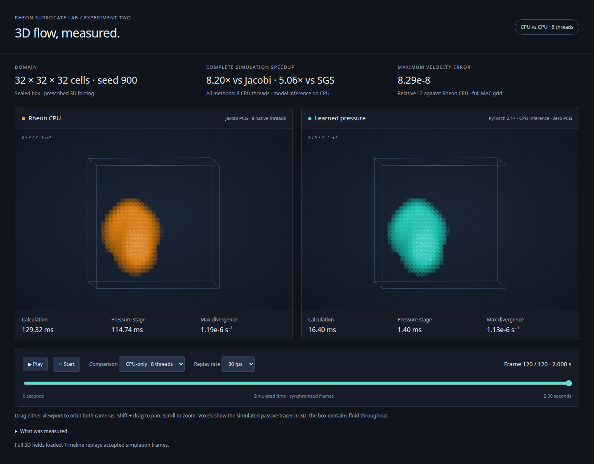

# Rheon Surrogate Lab

Controlled experiments in learned pressure prediction for Rheon. The lab preserves data contracts, checkpoints, negative results and numerical comparisons so each claim can be traced to an actual experiment.

## Start with the reference pipeline

Requires Git and Rust 1.92.0. From a clean committed checkout:

```sh
cargo test --locked
cargo run --release --locked -- generate data/smoke 4
cargo run --release --locked -- verify data/smoke
```

This generates 18 small pressure-only cases using a pinned Rheon dependency. Use a new output directory. No GPU, Python environment or paid service is needed for this path.

## Experiments and results

The documented **GroupNorm development diagnostic** found no solver benefit: all 32 raw predictions and learned warm attempts failed the native gates. Accepted solves required fresh previous-pressure fallback. [Measured result and limits](docs/plans/global-pressure-groupnorm-native-dev-run-v1/reports/measured-results.md).

The **earlier fixed-box modal model** has a separate result. With eight CPU threads per stage, median complete 120-frame times were 15.21 s Jacobi, 9.39 s SGS and 1.86 s learned pressure + Rheon: **8.20× / 5.06×** relative to those PCG paths. All 4,320 timed frames met the declared gates. Imports/model setup, warmup, field capture and rendering were outside that resident-rollout timer. [CPU receipts](experiments/trajectory-cpu-v1/README.md).



The historical viewer replays accepted 3D trajectories from the modal experiment.

That model supports one 32³ sealed box with prescribed forcing and passive tracer, without free surface, viscosity or obstacles. Agreement is with Rheon's discretization; an advantage over the available analytic spectral alternative was not established.

## Choose an experiment

- [Historical experiment guide](docs/experiment-history.md): pressure-only baselines, data format, frozen evaluation and trajectory reproduction
- [Tuldok project](tuldok/README.md): captured runtimes, recipes and training/restore custody
- [Global-pressure capture](experiments/global-pressure-v1/README.md): source and native-build contracts
- [GroupNorm candidate](experiments/global-pressure-v1/groupnorm-v1/README.md) and [native diagnostic](experiments/global-pressure-v1/groupnorm-native-dev-v1/README.md): preserved development protocol

Bulk datasets, native builds and run artifacts are generally ignored. Follow the selected experiment's exact prerequisites; public receipts do not replace missing inputs.

Licensed under [Apache-2.0](LICENSE). See [dependency provenance](THIRD_PARTY.md).
