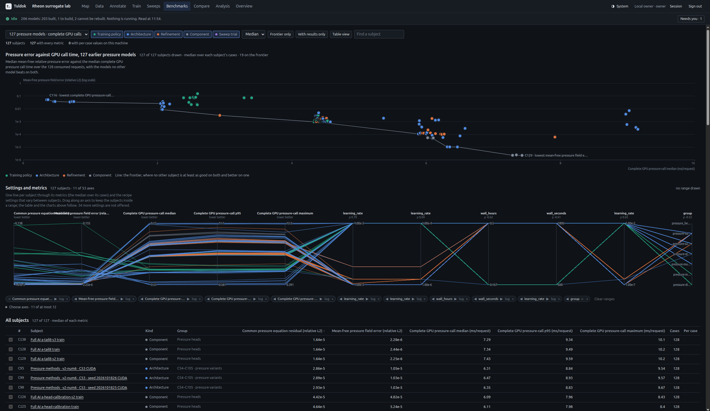

# Rheon Surrogate Lab

Learned fluid models trained on simulations from [Rheon](https://github.com/MrScripty/Rheon). The goal is a general fluid solver that runs much faster than the simulation it learned from: fast enough for real-time use in games, and, in a separate branch of models, accurate enough for engineering.



*The lab's results in [Tuldok](https://github.com/MrScripty/Tuldok): each point is a model; the line joins the models that no other model beats on both accuracy and speed.*

## Where things stand

- **206 earlier models** (October 2026), all on sealed boxes of water with no free surface, air, obstacles or open boundaries:
  - **pressure models** (most of them), which replace Rheon's iterative pressure solve inside its step: about **6–7 ms per GPU pressure call** at the best balance of accuracy and speed;
  - **35 full-state generators**, which take the whole state and produce the next one on the GPU: from **0.8 ms per 1/60 s step** (velocity error about 9 %) to **5.3 ms** (velocity error about 2·10⁻⁶) on grids up to 32³.

  The solver's own arithmetic written as a fixed GPU network (the "F64 composition") is still faster and more accurate on these simple boxes (0.25–0.6 ms per step), which is why the next models move to scenes where the solver is expensive. Each model's card and benchmark results are in [`projects/surrogate-lab/`](projects/surrogate-lab/); [the history](docs/history.md) summarises what was learned.
- **New models** live in [`surrogate/`](surrogate/README.md): a whole-step 3D U-Net stepper whose velocity changes are divergence free by construction, its training on its own rollouts, and one benchmark that scores every model the same way. It is written and tested, not yet trained.
- **Next**, in [the roadmap](surrogate/ROADMAP.md): a live playground in the browser to run a model in real time; new data from the current Rheon with many kinds of forces; several fluids in one domain; open and periodic boundaries; and two model branches, speed and accuracy.

## Layout

| Path | What it holds |
| --- | --- |
| [`surrogate/`](surrogate/README.md) | New models, dataset definitions, training and the shared benchmark (Python) |
| [`projects/surrogate-lab/`](projects/surrogate-lab/) | The lab's Tuldok project: definitions of datasets, models, recipes, benchmarks and charts, benchmark summaries in `results/`, model cards in `notes/fits/` |
| [`probes/reference/`](probes/reference/) | A small Rust driver around the pinned Rheon that produced the earlier data, used by `surrogate/` to generate scenes and as a benchmark baseline |
| `experiments/`, `earlier-run-code/`, `docs/plans/` | Only the scripts and protocols that built the earlier datasets and models, which the project's definitions cite |
| `scripts/` | How `projects/surrogate-lab/` was built from the earlier records, and the GPU runtime finder |
| [`CONTEXT.md`](CONTEXT.md) | The shared vocabulary: grids, spacing, density, pressure, gates |

## Two generations of data

All the earlier data and models come from **`rheon-reference-v1`**, Rheon at branch `lab/reference-solver-v1` (`bbe01bd3`), pinned by `probes/reference/`. New datasets come only from the current Rheon. The two are never mixed in one model or one benchmark, so the earlier models keep their own data and comparisons stay fair.

## Working with it

Tests run on the CPU in the lab's environment:

```sh
python3.12 -m venv .venv
.venv/bin/pip install -r requirements-cpu.lock --extra-index-url https://download.pytorch.org/whl/cpu
.venv/bin/python -m unittest discover -s surrogate -t .
```

The project is opened with Tuldok, from Tuldok's own checkout. With `TULDOK_DATABASE_URL` set:

```sh
.venv/bin/python -m tuldok_project check <lab>/projects/surrogate-lab
.venv/bin/python -m tuldok_project open  <lab>/projects/surrogate-lab
```

Then start Tuldok's app with `--project-folder <lab>/projects/surrogate-lab` to see the Map, the benchmarks and the models.

Weights, datasets and run logs are not in this repository. They live in Tuldok's project directory on the machine that made them (`python -m tuldok_project home` shows where). A fresh clone shows every earlier model with its card and results, but cannot rebuild them as they stand. New work is fully reproducible from its definitions.

Licensed under [Apache-2.0](LICENSE). See [dependency provenance](THIRD_PARTY.md).
