# Full AI study: completed results

The fixed pressure primary independently confirms **2.133 ms median CPU inference and 4.6963e-4 worst equation residual**. Warm small-grid benchmark; cold setup and native acceptance limitations remain separate. Original reserved-scene confirmation is complete for every frozen horizon and added seed. Primary K2/K3/K4 combined small-grid median passes: [(2, True), (4, True), (3, True)]. All intermediate fields, own240, failures, per-grid/tails,32³and setup costs remain reported separately. Application measurements are separate from model-only latency.

Targets: C107 successor at approximately 4 ms and worst equation error ≤7e-4; K=2,3,4 at <2 ms per generated step, with complete block latency reported and worst equation/field error ≤4e-3.

See [the original plan](plan.md), [progress notes](execution-progress.md), [raw frontier data](frontiers.json) and [accuracy export](accuracy.csv).

Analytical teacher controls and untrained prototype timings are excluded from candidate frontiers. Native pressure acceptance and long-run physical validity are evaluated separately.

| Queue | Status | Active command |
| --- | --- | --- |
| temporal-training-batch-02 | completed | — |
| architecture-training-batch-01 | completed | — |
| temporal-development-evaluation-batch-01 | completed | — |
| post-training-evaluation-batch-02 | completed | — |
| head-replication-batch-01 | completed | — |
| routed-qualification-batch-01 | completed | — |
| pressure-reserved-batch-01 | completed | — |
| temporal-mse-batch-01 | completed | — |
| temporal-mse-report-batch-01 | completed | — |
| temporal-global-batch-01 | completed | — |
| temporal-global-report-batch-01 | completed | — |
| pressure-whole-execution-batch-01 | completed | — |
| temporal-pressure-history-batch-01 | completed | — |
| pressure-confirmation-batch-01 | completed | — |
| temporal-component-ceiling-batch-01 | completed | — |
| tail8-replication-batch-01 | completed | — |
| causal-request-training-batch-01 | completed | — |
| factored-request-training-batch-01 | stopped | — |
| factored-request-training-batch-02 | completed | — |
| temporal-sharing-batch-01 | completed | — |
| temporal-sharing-postprocessing-batch-01 | completed | — |
| temporal-step-scaled-batch-01 | completed | — |
| temporal-increment-supervision-batch-01 | completed | — |
| temporal-curl-batch-01 | completed | — |
| temporal-pressure-expert-batch-01 | completed | — |
| temporal-pressure-expert-postprocessing-batch-01 | completed | — |
| temporal-decoder-batch-01 | stopped | — |
| temporal-decoder-batch-02 | completed | — |
| temporal-coupled-batch-01 | completed | — |
| temporal-provisional-batch-01 | completed | — |
| temporal-provisional-timing-batch-01 | stopped | — |
| temporal-provisional-timing-01 | failed | — |
| temporal-provisional-timing-batch-02 | completed | — |
| temporal-provisional-timing-02 | completed | — |
| coupled-CPU-stage-profile-batch-01 | completed | — |
| point-sampling-batch-01 | stopped | — |
| point-sampling-evaluation-batch-02 | completed | — |
| temporal-displacement-batch-01 | completed | — |
| temporal-displacement-postprocessing-batch-01 | completed | — |
| displacement-component-diagnostic-batch-01 | stopped | — |
| displacement-component-diagnostic-batch-02 | completed | — |
| displacement-CPU-stage-profile-batch-01 | completed | — |
| viscosity-calibration-batch-01 | completed | — |
| neural-viscosity-evaluation-batch-01 | completed | — |
| neural-viscosity-timing-batch-01 | completed | — |
| fast-preparation-timing-batch-01 | completed | — |
| fixed-viscosity-admission-batch-01 | completed | — |
| fixed-viscosity-training-batch-01 | completed | — |
| fixed-viscosity-postprocessing-batch-01 | completed | — |
| float32-map-evaluation-batch-01 | completed | — |
| float32-map-timing-batch-01 | stopped | — |
| float32-map-publication-batch-01 | completed | — |
| fixed-viscosity-k2-precision-evaluation-batch-01 | completed | — |
| fixed-viscosity-k2-precision-timing-batch-01 | stopped | — |
| fixed-viscosity-replication-admission-batch-01 | stopped | — |
| fixed-viscosity-replication-training-batch-01 | completed | — |
| fixed-viscosity-replication-admission-batch-02 | completed | — |
| fixed-viscosity-replication-postprocessing-batch-01 | completed | — |
| fixed-viscosity-replication-execution-batch-01 | completed | — |
| fixed-viscosity-replication-timing-batch-01 | completed | — |
| temporal-final-confirmation-batch-01 | completed | — |
| temporal-final-reserved-evaluation-batch-01 | completed | — |
| temporal-final-reserved-timing-batch-01 | completed | — |
| application-domain-change-batch-01 | stopped | — |
| application-domain-change-repair-batch-02 | completed | — |

## Additional temporal-cell seeds

These seeds share frozen learned component pretraining. Managed restoration and original-policy accuracy do not supply the separate selected float32/exact-execution qualification or CPU timing.

| Model | Seed ordinal | Exact managed fit/CPU restore | Eight-scene accuracy complete | Accuracy pass |
| --- | ---: | --- | --- | --- |
| b1-fixed-viscosity-s2 | 2 | True | True | True |
| b2-fixed-viscosity-s2 | 2 | True | True | True |
| b4-fixed-viscosity-s2 | 2 | True | True | True |
| b1-fixed-viscosity-s3 | 3 | True | True | False |
| b2-fixed-viscosity-s3 | 3 | True | True | True |
| b4-fixed-viscosity-s3 | 3 | True | True | True |

## Independent pressure outcomes

Accuracy uses all 768 small-grid requests; timing uses 48 fixed requests from the same 12 scenes, five balanced repeats. The 32³ extension is separate. The frozen primary is seed two.

| Model | Median CPU(ms) | Worst equation error | Native complete episodes |
| --- | ---: | ---: | ---: |
| C107 | 4.494 | 0.0014713 | 0/16 |
| a-head-calibration-routed | 4.604 | 0.00067324 | 0/16 |
| a-head-calibration-s2-routed | 4.542 | 0.000665672 | 0/16 |
| a-head-calibration-s3-routed | 4.878 | 0.000670362 | 0/16 |
| C107/original | 4.775 | 0.0014713 | 0/16 |
| C107/whole_graph | 3.654 | 0.0014713 | 0/16 |
| a-head-calibration-s2-routed/original | 4.759 | 0.000665672 | 0/16 |
| a-head-calibration-s2-routed/whole_graph | 3.712 | 0.000665672 | 0/16 |

All three calibrated seeds pass 7e-4. Original eager medians exceed 4 ms; complete-graph execution comparisons, when present, retain identical outputs on the already consumed cases and do not claim a new independent accuracy population. Every native attempt rejects at step one under unchanged gates. No application throughput is claimed.

## Earlier compiled-head confirmation

A second bank was reserved and captured after freezing complete-graph execution. All output pressures are bitwise equal to original eager execution. Accuracy uses all 768 small-grid requests; timing uses 48 fixed requests in five balanced repeats.

| Model | Median CPU(ms) | Worst equation error | Target met |
| --- | ---: | ---: | --- |
| C107/whole_graph | 3.496 | 0.00117714 | False |
| a-head-calibration-s2-routed/whole_graph | 3.908 | 0.000798588 | False |

The successor passes 766 of 768 small-grid requests at 7e-4. Two startup requests on 15×6×8 grids exceed the accuracy target. That preceding model passes median speed but fails the combined target. The later learned-tail confirmation is reported below. Native acceptance remains unmet. Per-geometry trace preparation costs approximately 0.45–0.53 seconds; total numerical worker setup after module imports is 3.96 seconds, including three traces. This setup metric excludes Python/Torch import time. The confirmation worker peaks at approximately 0.98 GB RSS; the earlier many-layout benchmark peaked at approximately 3.86 GB. Warm timing excludes setup; short episodes must account for these costs.

## Learned final block: development comparison

The new learned eight-mode final block completes its managed 10,000-update fit and exact CPU restore. It reaches 2.2551e-4 worst historical equation error and 5.5614e-4 on the most recent 768 small-grid requests. These are consumed development populations. Five balanced serial compiled repeats measure 4.370 ms historically and 4.802 ms on the recent small-grid mix; its parent measures 4.624 ms in the same run. That version improves accuracy while missing speed; the subsequent precise-execution results appear below. Compilation passes 2,176-request numerical qualification, with small floating-point differences from eager. See [the complete result and custody](tail-head-results.md).

A separate offline true-future-RHS diagnostic now passes all 384 pressure-component queries. It is excluded from temporal candidate frontiers. A materialized learned CNN execution pilot fails its initial numerical qualification and remains excluded while precision is investigated. See [that bounded execution investigation](materialized-pressure-execution-notes.md).

## Qualified precise learned execution

The precise routed path measures 1.909 ms historically and 2.075 ms on the consumed recent small-grid mix, at 2.2550e-4 and 5.5613e-4 worst equation error respectively. The paired complete CNN measures 4.586 ms on the recent mix. Full 2,176-request qualification preserves target classifications and keeps output/equation differences within the unchanged tolerances. Both requested targets pass on that development population; independent confirmation is reported separately below.

This median spans heterogeneous small grids: 16³ still measures approximately 7.93 ms, and 32³ approximately 83 ms. Cold setup and geometry-specific cache memory are substantial. The paired 64-geometry worker takes 179.43 seconds to prepare and peaks at 7.30 GB RSS while retaining both paths; its dense coefficient cache is approximately 419 MiB. This is not a standalone candidate memory measurement. For 9×11×11, observed per-geometry preparation is 3.09 seconds, giving approximately 14.94 ms per request if amortized over 240 requests. Warm target success is not cold application throughput. See [per-grid timings, cold accounting and evidence](precise-routed-pressure-results.md).

The causal pressure-request data view and neural objective now pass CPU/CUDA qualification for all four K values and all grid groups. The completed causal component outcomes are reported below; no full-state temporal advantage is claimed. See [the bounded next component fit](causal-pressure-request-component-plan.md).

## Independent pressure target confirmed

The fixed primary independently reaches **2.133 ms median CPU inference and 4.6963e-4 worst equation residual**. All 768 small-grid requests pass, and both continuation seeds confirm the combined target. C107 receives the same optimization: 1.642 ms but 1.5620e-3 worst residual. The primary was fixed before capture and was not replaced after seeing results.

This is the warm heterogeneous small-grid benchmark. The primary has approximately 7.08 seconds of worker setup after module imports and peaks near 0.98 GB RSS with three layouts. Larger grids, cold costs and per-grid timings remain separate. All models reject at the first native step on all 16 scenes under unchanged stricter gates; no application throughput is claimed. See [all four independent results and runtime-recovery evidence](pressure-confirmation-v2/results.md). Full-state multi-step accuracy and own-history goals remain open.

## Causal pressure components

Both managed request fits and exact CPU restores are complete. Factoring a learned linear flux response from nonlinear transport reduces small-grid development median pressure error from 0.62780 to 0.059804 and worst error from 5.2160 to 0.64678. Cold starts pass, later evolution fails. These pressure-only reference-history queries supply no full-state or own-history claim, and neither component enters the temporal frontier. See [all component results](factored-pressure-request-results.md).

Both requested sharing architectures now have complete managed fits, CPU restores, every-horizon development evaluation, 240-step own-history checks and five balanced CPU timing repeats. All six pass the small-grid median speed budget at0.85–1.47ms per generated step, but none passes accuracy. Individual latency tails are slower;32³ remains11.44–19.66ms per step. See [all six endpoint/reuse comparisons](temporal-sharing-results.md); short-block and long-rollout outcomes remain separate.

The two controlled K2 step-unit conditioning fits and development comparisons are complete. See [their accuracy and control audit](temporal-step-scaled-results.md). CPU speed remains a separate unmeasured gate for those new fits.

The matched full-state and increment-weighted MSE fits, CPU restores and all-horizon development evaluations are complete. See [their audited comparison](temporal-increment-supervision-results.md). New CPU latency remains a separate gate.

The generative curl representation fit, CPU restore and all-horizon development/rollout comparison are complete. See [accuracy, physical diagnostics and matched controls](temporal-curl-results.md). Constraint satisfaction alone does not establish prediction accuracy.

The causal full-state pressure-expert fit, exact CPU restore and all-horizon development/own-history comparison are complete. See [the full-state result and declared controls](temporal-pressure-expert-results.md). Its new weights have no measured CPU latency; pressure-only component timing is not a complete-block claim.

The combined lead-time/gauge/passive-tracer decoder fit, exact CPU restore and full development/own-history comparison are complete. See [the complete errors, controls and predeclared diagnostics](temporal-decoder-results.md). Structural representation properties alone do not qualify prediction accuracy; new CPU latency remains unmeasured.

The coupled K2 fit, exact CPU restore and eight-scene development evaluation are complete. See [the full-state result](temporal-coupled-results.md). Incomplete rollouts retain their raw failures and finite-prefix diagnostics, with no complete-interval worst-error claim. CPU timing, K3/K4 extensions and reserved evaluation remain separate gates.

Train-only counterfactuals identify provisional transport as the next fluid limitation. Exact reference pressure alone barely changes warm velocity error; reference provisional velocity reduces its worst to 2.825e-5. These future-reference controls are excluded from candidate frontiers. The unchanged model reproduces its prior fitting metrics bitwise. See [the diagnostic evidence](temporal-coupled-transport-results.md).

Both matched provisional-supervision continuations, exact CPU restores and full development/own240 evaluations are complete. See [the audited comparison](temporal-provisional-results.md). Only the training auxiliary weight differs; no new CPU timing is claimed.

Offline tracer controls reproduce all 256 native outputs exactly when native displacements are supplied. A first-order scalar replay with native velocity history reaches 0.001207 worst tracer error through 128 steps on small training grids. These are representation/transport controls, with no learned displacement predictor or full-state/240-step pass. See [the native readout checks](tracer-representation-results.md) and [reference-velocity replay](tracer-reference-velocity-replay-results.md). Neither joins the candidate frontiers.

The parent and both continuations now have complete five-repeat CPU cost measurements. Small-grid complete blocks take about 5.6 ms, or 2.8 ms per generated step, above the 4 ms/two-state budget. They also fail accuracy. Larger-grid cost, latency tails, worker preparation and memory remain separately reported. See [actual CPU costs and their exact accuracy joins](temporal-provisional-cost-results.md).

The CPU profile identifies the tracer decoder and field/forcing work as substantial small-grid costs. A preliminary denormal-policy screen shows no speed benefit and is not adopted. These instrumented/selected-case diagnostics are excluded from frontiers. See [the stage profile](coupled-CPU-stage-profile-results.md).

The training-only face/cell transport labels and fixed convex readout pass all 80 registered cases on each of CPU and CUDA. Given native displacements, velocity and tracer outputs match the native primitive exactly at float32 precision; field/shift gradients are repeatable. This qualifies representation and labels, with zero training updates and no learned forecast or latency claim. See [the transport qualification](displacement-transport-results.md).

The 972-coefficient point layer completes 1,000 managed CUDA updates and an exact CPU restore. Its published float32 coefficients pass 24 native geometry/density checks at 2.51e-8 worst relative error. This is a learned initialization component, with no full-state accuracy, rollout or latency claim. See [component custody and native checks](point-sampling-results.md).

The actual displacement model and training objective pass all 64 CPU and 64 CUDA constructor cases across K=1/2/3/4. Two-block gradients, shared computation, passive tracer and training-teacher isolation qualify with zero updates. Full-state fitting, development/own240 accuracy and actual CPU timing remain separate gates. See [the implementation checks](temporal-displacement-qualification-results.md) and [bounded model plan](temporal-displacement-plan.md).

The displacement K2 fit, exact CPU restore and all eight development scenes are complete. Every horizon and own-history interval retains its actual accuracy outcome and raw failures. See [the full-state comparison and controls](temporal-displacement-results.md).

The displacement model also has five-repeat full-block and tensor CPU measurements against unchanged coupled baselines. Accuracy and timing are joined by exact restored model identity. These reference-history block costs do not establish sustained application throughput. See [actual CPU costs](temporal-displacement-cost-results.md).

Training-only controls identify the learned viscosity head as the main remaining fluid limitation. On the high-density 128-step training replay, native viscosity reduces worst equation error from 0.01166 to 0.000566; native displacement alone barely changes fluid error. The separate profile measures about 1.59 ms per small-grid block in the fixed field readout. These numerical controls and instrumented costs are excluded from candidate frontiers. See [the component diagnosis and stage profile](displacement-component-results.md).

The managed 243-coefficient neural viscosity calibration repairs the remaining K2 accuracy failure. All eight development scenes and every horizon through own240 pass, with worst error 0.0033941. The fused readout preserves all 3,856 physical outputs byte for byte. Five balanced CPU repeats measure 4.7793 ms per complete small-grid block, or 2.3896 ms per generated step, so speed still misses the 4 ms block budget. 32³ takes 183.0 ms per block; latency tails and setup remain separate. K3/K4, replicas, reserved scenes and application timing remain open. See [full-state accuracy](neural-viscosity-results.md) and [exact fused execution costs](neural-viscosity-cost-results.md).

The next execution variant preserves all 3,856 physical outputs byte for byte while fusing prescribed forcing and removing unused pressure-input conversions. Its five-repeat complete small-grid K2 median is 3.9522 ms (1.9761 ms/state); combined accuracy/speed target met: True. Every intermediate output and own240 remain included. Larger grids, tails, replicas and sustained application/event costs remain separate. See [qualified execution costs](fast-preparation-cost-results.md) and [the corrected K1/2/3/4 family](fixed-viscosity-family-plan.md).

The four corrected-family managed CUDA fits, exact CPU restores and every-output/own240 evaluations complete. Accuracy-qualified models across all eight scenes: ['b1-fixed-viscosity', 'b2-fixed-viscosity', 'b3-fixed-viscosity', 'b4-fixed-viscosity']. The managed viscosity coefficients are frozen from initialization and each model supervises36,000physical states. Actual optimizer work differs with K; there is no equal-FLOP claim. See [full-state errors and actual training controls](fixed-viscosity-family-results.md).

Corrected-family small-grid combined accuracy/median-speed qualifiers: ['b3-fixed-viscosity-fast', 'b4-fixed-viscosity-fast']. Five balanced CPU repeats include complete2/3/4-call sequential B1 controls. Every fast execution policy retains all physical outputs byte for byte; preparation, memory,32³and latency tails remain separate. See [exact CPU costs and accuracy joins](fixed-viscosity-cost-results.md).

Float32 arithmetic for the derived learned pressure map receives a new complete evaluation with unchanged trained tensors. All-eight-scene accuracy qualification: True. Worst small-grid own240 error is0.0033953; no physical-byte equivalence or inherited accuracy is claimed for this rounding change. Its separately reported paired CPU comparison uses the same composed checkpoint; new-family weights need their own accuracy qualification. See [actual float32-map accuracy](float32-learned-map-results.md).

Float32-map five-repeat median complete K2 latency is 3.7069 ms (1.8534 ms/state), with actual own240 worst error 0.003395266; combined small-grid median target met: True. See [actual map-arithmetic costs and accuracy joins](float32-map-cost-results.md).

[Completed managed additional-seed accuracy audit](fixed-viscosity-replication-results.md).

[Actual three-seed CPU costs and matched sequential controls](fixed-viscosity-replication-cost-results.md).

[Original reserved-scene accuracy for every frozen model](temporal-reserved-accuracy-results.md).

[Fresh reserved CPU costs and all retained outcomes](temporal-reserved-cost-results.md).

[Full measured application and interaction episodes](application-results/results.md).

[Actual fresh predictions after supported physical-box boundary changes](application-domain-change-results.md).

The selected K2 deployment uses float32 pressure-map arithmetic while B1uses float64. Their comparison measures complete deployment choices, including both precision and computation sharing; it does not isolate the encoder reuse contribution. The K4/B1comparison uses float64 for both.

Application preparation qualifies bounded native transport and exact eight-step restart on the odd grid and32³. Twelve real neural/native mechanics cases verify state handoff, event invalidation and unsupported-boundary stopping; their K1/3/4views use the K2checkpoint and do not count as independent horizon fits or accuracy results. All eight declared development forcing-event references are captured, with their0..13field/RHS prefixes byte-identical to the original steady bank. These are preparation artifacts, with no application speed or native physical-acceptance claim. See [the application measurement scope](application-evaluation-plan.md) and [mechanics protocol](forecast-application-qualification-protocol-01.json).

New offline native controls distinguish accumulated pressure from a last-pressure approximation. Using true future pressures on consumed training scenes, the two-step pressure-prefix control reaches4.96e-5worst cold velocity error versus0.0969using twice the endpoint pressure. These are diagnostic ceilings, not causal predictions or frontier points. Neural momentum coefficients shared with the pretrained flux layer also match the native primitive within2.70e-8relative. See [the offline evidence](tied-momentum-results.md) and [next coupled full-state plan](temporal-coupled-dynamics-plan.md).

## Simultaneous-state primary screen

Complete inference includes encoding, forcing construction, all horizons and physical reconstruction. Error is the worst of equation, pressure, velocity and tracer across every development output.

| Model | K | Full block(ms) | Per generated step(ms) | Worst equation/field error | Target met |
| --- | ---: | ---: | ---: | ---: | --- |
| K=2 | 2 | 1.722 | 0.861 | 1.26426 | False |
| K=3 | 3 | 1.831 | 0.610 | 1.50973 | False |
| K=4 | 4 | 2.148 | 0.537 | 1.94049 | False |
| b2-endpoint | 2 | 2.949 | 1.475 | 1.63989 | False |
| b2-reuse | 2 | 2.864 | 1.432 | 1.74979 | False |
| b3-endpoint | 3 | 3.113 | 1.038 | 1.91647 | False |
| b3-reuse | 3 | 3.202 | 1.067 | 1.89237 | False |
| b4-endpoint | 4 | 3.419 | 0.855 | 1.68954 | False |
| b4-reuse | 4 | 3.645 | 0.911 | 1.75717 | False |
| b2-coupled | 2 | 5.753 | 2.877 | 0.429132 | False |
| b2-provisional-control | 2 | 5.591 | 2.796 | 0.428757 | False |
| b2-provisional-aux | 2 | 5.587 | 2.793 | 0.446819 | False |
| b2-displacement | 2 | 6.350 | 3.175 | 0.0164246 | False |
| b2-displacement-viscosity | 2 | 6.075 | 3.037 | 0.00166756 | False |
| b2-displacement-viscosity-fused | 2 | 4.779 | 2.390 | 0.00166756 | False |
| b2-displacement-viscosity-fast | 2 | 3.952 | 1.976 | 0.00166756 | True |
| b2-fixed-viscosity-fast | 2 | 4.124 | 2.062 | 0.00168558 | False |
| b3-fixed-viscosity-fast | 3 | 5.574 | 1.858 | 0.00181892 | True |
| b4-fixed-viscosity-fast | 4 | 7.433 | 1.858 | 0.00198854 | True |
| b2-displacement-viscosity-fast-f32map | 2 | 3.707 | 1.853 | 0.00166724 | True |
| b2-fixed-viscosity-fast-float64 | 2 | 4.084 | 2.042 | 0.00168558 | False |
| b2-fixed-viscosity-fast-float32-map | 2 | 3.545 | 1.772 | 0.00168523 | True |
| b2-fixed-viscosity-fast-float32-map/seed-confirmation | 2 | 3.666 | 1.833 | 0.00168523 | True |
| b4-fixed-viscosity-fast-float64/seed-confirmation | 4 | 6.898 | 1.725 | 0.00198854 | True |
| b2-fixed-viscosity-s2-fast-float32-map/seed-confirmation | 2 | 3.590 | 1.795 | 0.00147837 | True |
| b4-fixed-viscosity-s2-fast-float64/seed-confirmation | 4 | 6.957 | 1.739 | 0.00183873 | True |
| b2-fixed-viscosity-s3-fast-float32-map/seed-confirmation | 2 | 3.579 | 1.789 | 0.00182713 | True |
| b4-fixed-viscosity-s3-fast-float64/seed-confirmation | 4 | 6.988 | 1.747 | 0.00186015 | True |

The controlled K1 relative-MSE follow-up is complete. Its 24 comparison checks verified exact initialization, sampling work, architecture and inputs. It still fails accuracy: global worst single-block equation error is 1.06879 versus 1.03072 for the original objective. See [all intervals and fitting diagnostics](temporal-loss-followup-results.md). No new latency or bundled-model advantage is inferred from this negative test.

The shared-global K1 capacity comparison is also complete. Its managed fit and exact CPU restore retain the original data, objective, sampled work and training loop. Some velocity and rollout errors improve, but startup pressure still has approximately 100% relative error. Capacity alone has not established the required fitting accuracy. See [the full comparison](temporal-global-results.md) and [the user's endpoint/reuse architecture options](multi-step-generation-options.md).

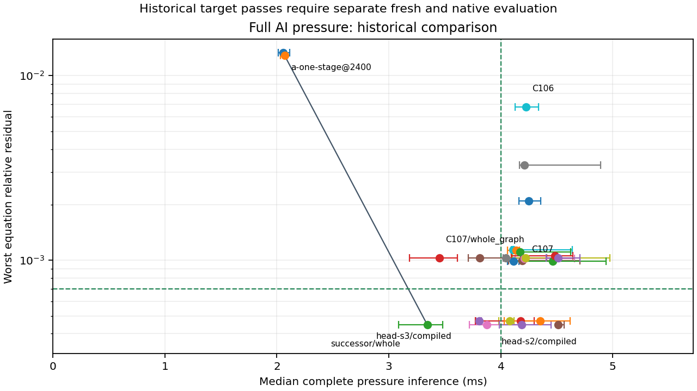

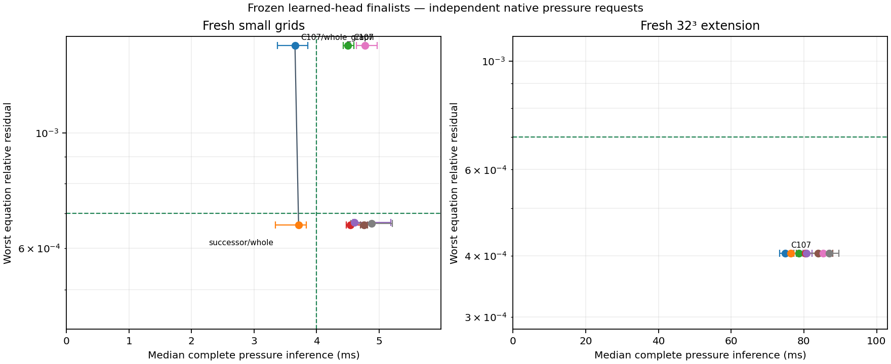

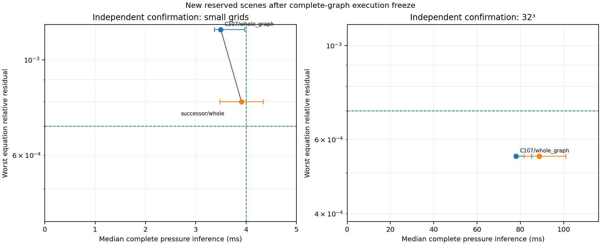

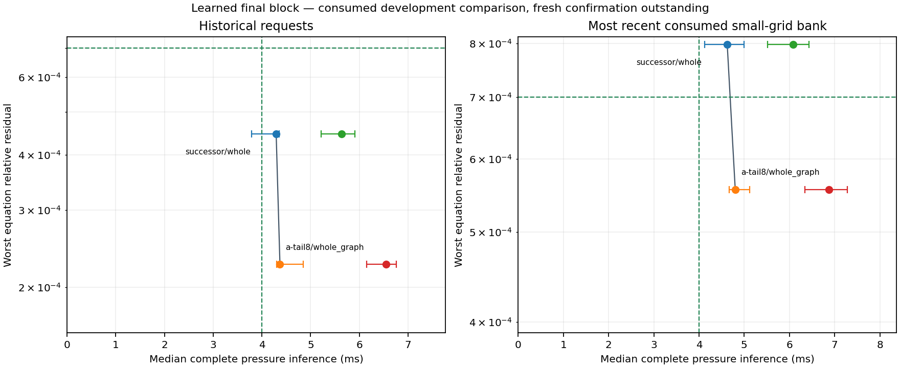

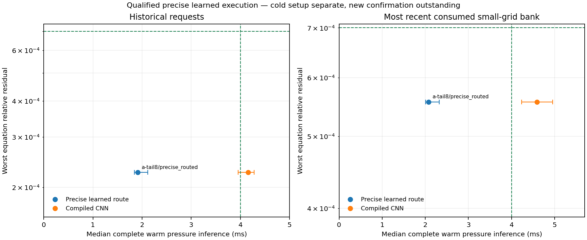

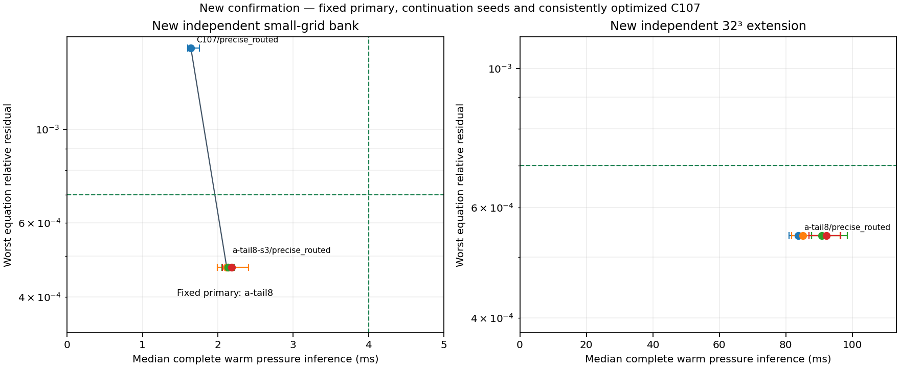

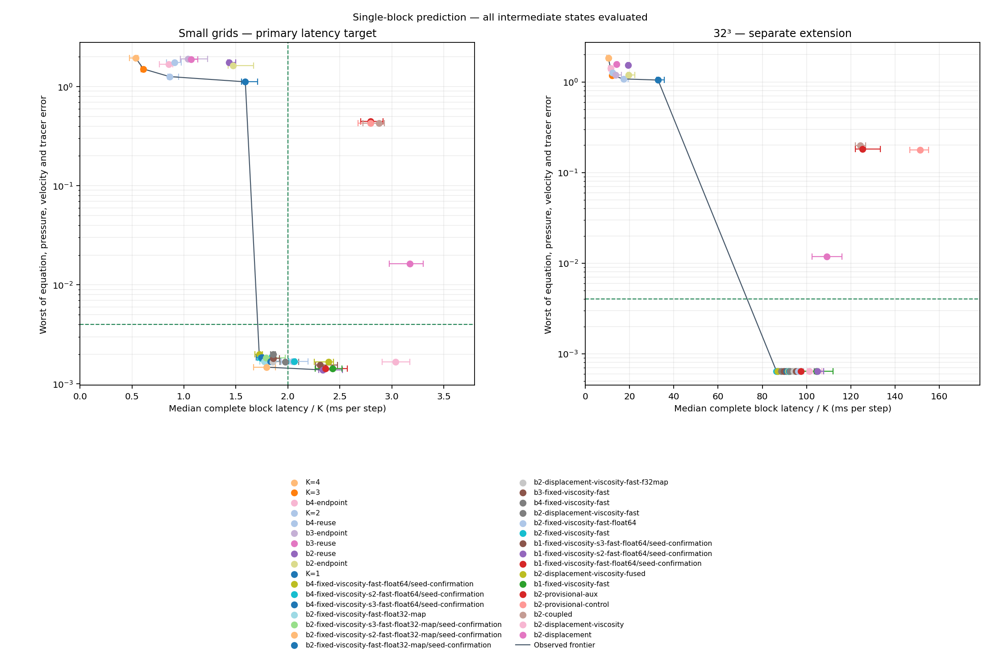

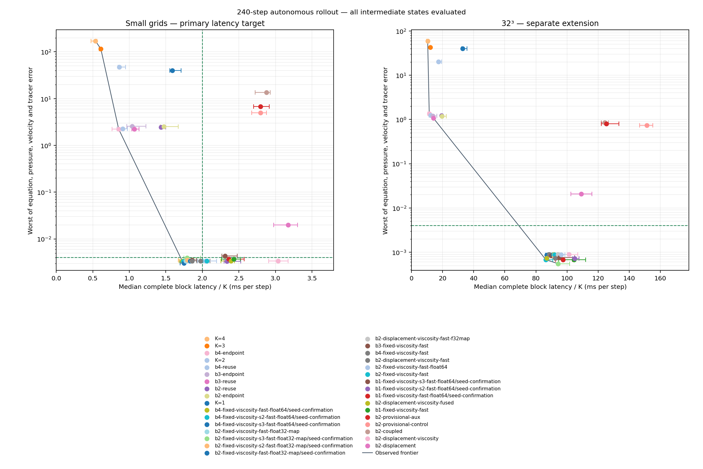

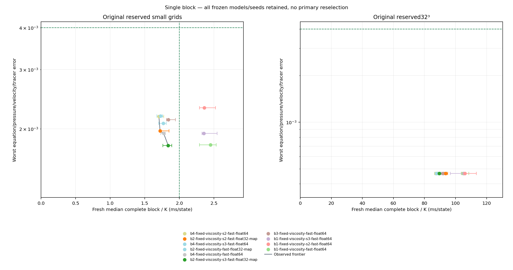

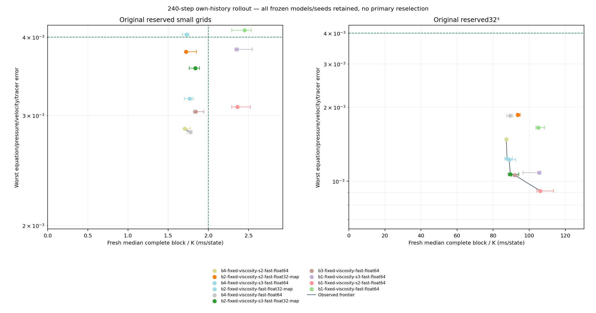

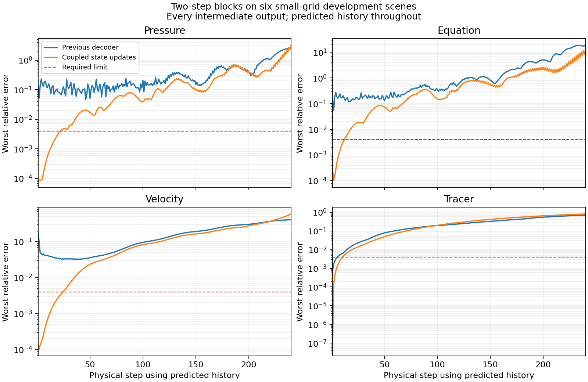

The pressure plot uses the 128 consumed historical requests. The temporal plots use the 8 development scenes, separating small grids and 32³; the error is the worst across every output horizon and every declared field. Horizontal bars span the five repeat medians; they are not confidence intervals. Timing populations and error populations are documented in their raw receipts. Native and event receipts are linked in the progress notes. Rejected native attempts do not establish simulation throughput.
