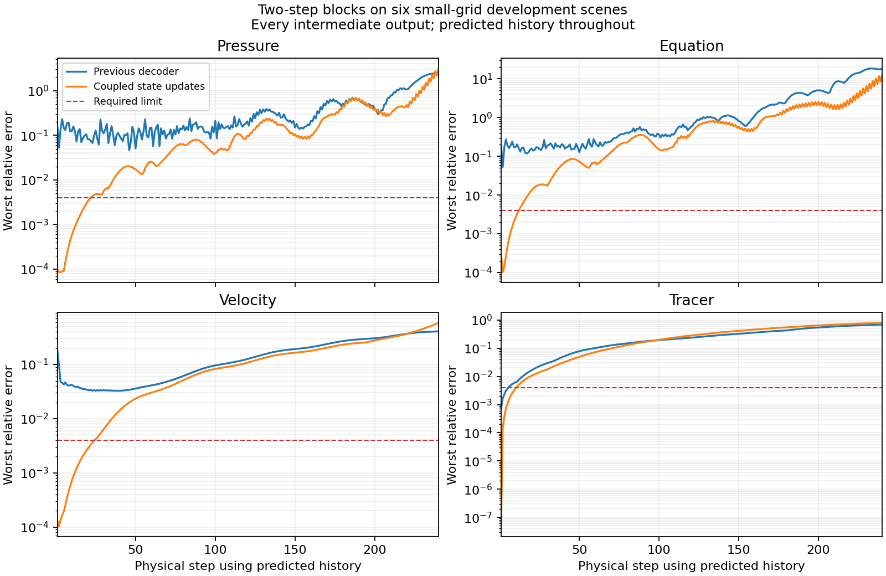

# Coupled full-state generation comparison

The K2 coupled fit completes 10,000 updates and an exact zero-update CPU restore. The data, sample stream, supervision and counted target work match the decoder control. Architecture widths differ (16 for the decoder and 12 for the coupled model), as do internal arithmetic and parameter count; this does not isolate a single cause.

| Regime | Interval | Complete | Worst P / equation / velocity / tracer | Accuracy pass |
| --- | --- | --- | --- | --- |
| small | single_block | True | 0.1041294 / 0.429132 / 0.005250663 / 0.01013463 | False |
| small | own_history12 | True | 0.0008952936 / 0.003864151 / 0.001031768 / 0.005013904 | False |
| small | own_history48 | True | 0.02041432 / 0.08492052 / 0.02167829 / 0.04542965 | False |
| small | own_history240 | True | 3.14345 / 13.53462 / 0.5900939 / 0.8088153 | False |
| 32cubed | single_block | True | 0.05512893 / 0.1990091 / 0.0009131977 / 0.003263803 | False |
| 32cubed | own_history12 | True | 0.0004192906 / 0.001249018 / 0.0004879196 / 0.0008344201 | True |
| 32cubed | own_history48 | True | 0.004936913 / 0.01872037 / 0.003190142 / 0.009894492 | False |
| 32cubed | own_history240 | True | 0.2561076 / 0.8504166 / 0.08128572 / 0.3682457 | False |

All eight development scenes are evaluated. Any failed block returns no fabricated states; its observed finite-prefix maximum is retained separately and cannot establish a complete-interval worst error. See the machine-readable result and raw scene records.

The model has 100,611 parameters, of which 7,970 are trainable. It encodes once per block and counts every internal latent, neural pressure, flux, momentum and tracer readout. Dense learned pressure maps have separate setup and memory costs and use the original component on 32³.

No new CPU latency is claimed. Complete-block timing and all requested horizons remain separate qualification gates. The eight reserved temporal scenes remain unopened.

The first reporting audit incorrectly required equal architecture widths. It stopped before writing results. The corrected audit checks the coupled width against its unchanged preregistration and reports the difference. Both attempts are retained; no fit, restore or evaluation was repeated.

[Results and source hashes](temporal-coupled-results.json) · [Registered comparison](temporal-coupled-registration-01.json) · [Previous decoder](temporal-decoder-results.md) · [Original plan](plan.md)
