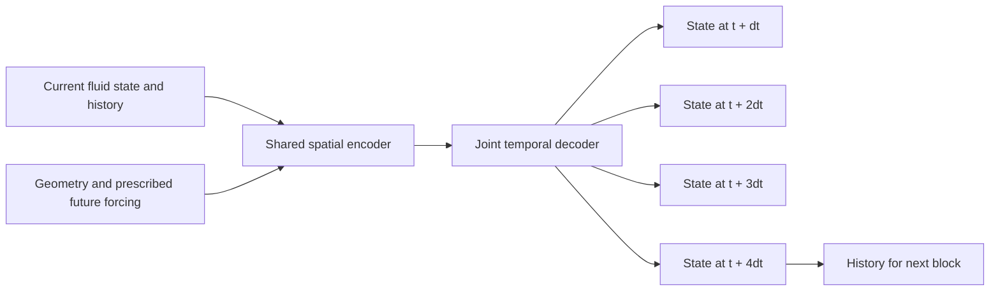

# Predicting multiple fluid simulation steps per model evaluation

Research date: 2026-10-18. This note investigates future temporal prediction; it does not change the active [pressure-methods-v2 campaign](pressure-methods-v2/plan.md), run training, or establish a new performance result.

## Finding

Predicting several future **physical states** in one network evaluation is an established research direction. The closest terms are **temporal bundling**, **direct multi-horizon prediction**, **space-time neural operators**, and **learned coarse time integration**. For Rheon, the most useful initial comparison would be a short block predictor returning 2, 4, or 8 future velocity/tracer states, compared with a model that jumps directly to the block endpoint. A shared state encoder with inexpensive time-conditioned output heads is another practical design. These are proposed experiments, not measured Rheon capabilities.

DLSS and FSR supply a useful computation-sharing analogy, but their generated images are not new pressure/velocity simulation states. Two distinct questions must remain separate: generating additional display frames and advancing the simulator to a future physical state.

## What frame generation actually contributes

AMD's current first-party description says its ML frame generation synthesizes intermediate image colors from two consecutive source images, using optical flow and motion vectors. It has the start and end images available. Its older analytical FSR implementation is also interpolation, so “FSR” does not identify one universal neural architecture. Neither description claims to advance a fluid equation or maintain a physical state. [AMD FSR Frame Generation](https://gpuopen.com/amd-fsr-framegeneration/)

NVIDIA's DLSS 4 technical report describes splitting the frame-generation network: an expensive component executes once per input image pair, and a smaller component executes once per generated image. Multiple generated frames therefore share substantial work, but do not have zero marginal cost. The report describes real-time interpolation, not a replacement for game simulation. [DLSS 4, §2.2–2.2.1](https://research.nvidia.com/labs/adlr/DLSS4/)

**Our inference:** reuse the expensive encoding of the current fluid state and geometry, then decode several requested future times. For online simulation those future states must be predicted from current/past information and prescribed future forcing. Supplying a true future endpoint from a recorded trajectory would instead test interpolation and would overstate an online predictor's capability. If only smoother playback is needed, interpolation could be a separate product feature; it should have separate accuracy and timing claims.

This proposed four-step predictor shares encoding while retaining an explicit cost for producing and correcting each output:

## Primary research and its relevance

| Approach | What one evaluation returns | Evidence and important qualification |
| --- | --- | --- |
| Temporal bundling | A block of K future fields | Direct match for the user's request; time advances across the returned block. |
| Space-time neural operator | A complete trajectory over a learned interval | Genuine joint space/time prediction, with a potentially large activation and output footprint. |
| Lead-time-conditioned operator | State at a specified future time | Can skip intermediate states; requesting all intermediate frames can require additional evaluations or batched queries. |
| Latent dynamics | Future compressed states, decoded when needed | Reduces computation per transition; not necessarily fewer sequential transitions. |
| Coarse numerical evolution with learned correction | A future coarse-time state | Can replace expensive fine evolution; count internal substeps, numerical work and correction calls. |
| Time-parallel predictor/corrector | Corrected trajectory windows on parallel resources | Reduces wall time through additional parallel work; different from one-pass inference. |

### 1. Temporal bundling: the closest match

Brandstetter, Worrall and Welling's **Message Passing Neural PDE Solvers** explicitly predicts K future solution fields synchronously. Its decoder produces the whole block; subsequent blocks still roll out autoregressively. Their “pushforward trick” is a separate training procedure exposing the model to its own predictions, and entails additional training forwards; it is not itself parallel future-state output. The demonstrations concern 1D/2D fluid-like PDE problems, not a qualified 3D incompressible pressure replacement. Their appendix also applies bundling to CNN and FNO baselines, so the output strategy is not restricted to graph networks. [Original paper, §3.1 and Appendix F](https://arxiv.org/html/2202.03376v3)

**Rheon implication:** change the learning target from one prepared pressure request to an actual sequence of future states. One encoder and a K-output decoder could amortize much of the network. A separate projection or correction applied to each output would remain K pieces of work and must be timed.

The **Temporal Neural Operator**, Diab and Al-Kobaisi, provides another explicit implementation: its decoder returns a K-step bundle, then feeds the final predicted state into the next block. Its four-day bundled temperature forecasts illustrate the mechanism, but the cited demonstrations are temperature/PDE forecasting rather than our 3D coupled pressure/velocity solver. This is architectural evidence, not a transferable accuracy or speed benchmark. [Original paper, §3 and temperature experiments](https://arxiv.org/html/2504.20249v1)

### 2. Space-time FNO: predict a whole trajectory jointly

The original **Fourier Neural Operator** paper distinguishes recurrent FNO-2D from FNO-3D: the latter maps initial time slices directly to a future trajectory by convolving jointly over space and time. Here “3D” means **two spatial axes plus time**, not a 3D fluid volume. The evaluated fluid is periodic, incompressible 2D Navier–Stokes in vorticity form. Its learned interval is fixed, although output time discretization can change. Data sufficiency matters: the paper reports poor errors for all tested methods in its more data-limited difficult regimes. [Original FNO paper, §5.3–5.4](https://arxiv.org/html/2010.08895v3)

**Rheon implication:** a full 3D-space-plus-time version is conceptually relevant but increases memory and training requirements. A modest K-output spatial model is an easier first comparison than an unrestricted 4D space-time architecture. Mesh-independent evaluation also does not establish generalization to unseen geometry, spacing, physical extent or forces.

### 3. Time-conditioned operators: jump to the endpoint

**Poseidon** uses a time-conditioned multiscale operator transformer. Its all2all training pairs earlier and later snapshots from each trajectory with their lead time; this creates multiple transition durations without treating all pairs as independent new simulations. It supports either direct evaluation at the requested time or repeated shorter predictions. Importantly, Appendix D.6.2 reports that the preferred strategy depends on the problem: recurrent evaluation worked better on its NS-PwC Navier–Stokes task, while direct evaluation worked better on Wave-Layer. All2all training also has quadratic pair growth unless subsampled. [Original paper, §2 and Appendix D.6](https://arxiv.org/html/2405.19101v2)

**Rheon implication:** compare `state(t), K·dt → state(t+K·dt)` against block output. If the application needs only the endpoint, this avoids constructing all intermediate fields. If it needs every field for rendering, interaction, force evaluation or diagnostics, endpoint prediction alone does not meet that requirement. We should not assume larger temporal jumps improve long-run accuracy.

### 4. Learned larger timesteps: concrete fluid evidence

Stachenfeld and colleagues' **Learned Coarse Models for Efficient Turbulence Simulation** predicts state increments at coarser timesteps. Experiments include 2D incompressible velocity and 3D compressible density/velocity/pressure. Temporal-coarsening tests show a tradeoff: larger jumps worsen one-step accuracy, but very small jumps can accumulate more rollout error; an intermediate timestep performed best. Their prominent 1000× wall-time comparison combines spatial and temporal coarsening and GPU-versus-CPU execution. It is not an isolated multi-frame speedup and should not be applied to Rheon. [Original paper, §3–5](https://arxiv.org/html/2112.15275v3)

**Rheon implication:** a direct 2/4/8-step endpoint model is scientifically well motivated. Evaluate physical time advanced per second at equal allowed trajectory error, not inference latency alone or a common count of model calls.

### 5. Latent evolution: amortize representation work

**LE-PDE** encodes the physical state into a compact global representation, advances that representation, and decodes when required. It can incorporate temporal bundles, but repeated latent evolution is still recurrent computation. Its experiments include Navier–Stokes, and it distinguishes full runtimes from cheaper latent-only runtimes. Conservation is encouraged through training rather than generally enforced. [Original paper, §3 and limitations](https://arxiv.org/html/2206.07681v2)

**Rheon implication:** this is attractive when spatial inference and state transfer dominate and only occasional full states are needed. If every intermediate velocity/tracer grid must be reconstructed, decode and memory costs return. Compression also needs a measured error budget; latent evolution accuracy cannot repair details the encoder discarded. A persistent latent state could reduce repeated encoding across blocks, but changing boundary conditions or user interaction must be represented.

### 6. Hybrids and misleading uses of “multi-step”

**MultiPDENet** combines coarse-grid physical evolution with neural corrections. Its macro update contains multiple microsteps, including a physics block with RK4 and Poisson work. It demonstrates Navier–Stokes prediction, but a wrapper called once still executes internal sequential work. [Original paper, §3.2](https://arxiv.org/html/2501.15987v1)

**PDE-Refiner** improves rollout fidelity through repeated denoising/refinement evaluations at each prediction. It specifically studies errors in weak spectral components, including some low-frequency components. It is useful for our spectral-error question, but spends additional calls on accuracy rather than generating K physical steps in one evaluation. Its “refinement steps” must not be confused with simulation timesteps. [Original paper, §3–4](https://arxiv.org/html/2308.05732v2)

**Neural-Parareal** uses a learned coarse propagator with parallel fine-solver windows and repeated correction cycles, demonstrated for fusion MHD. It trades additional total work and HPC resources for time to solution; its ideal speedup depends on the number of windows and correction cycles. This is a possible offline batch direction, not an established one-GPU online shortcut for Rheon. [Original paper, §2 and §5](https://arxiv.org/html/2405.01355v1)

## Why this needs different training targets from our pressure solver

Our [terminology](../../CONTEXT.md) distinguishes a pressure correction pass, which refines one pressure request without advancing time, from a simulation timestep, which advances the physical state. The [completed methods campaign](pressure-methods-v1/results.md) trained pressure-equation policies; its finer-teacher experiment retained a fixed model equation and did not establish exact fine-integrated coarse trajectory labels. These are different tasks from predicting future velocity and tracer.

**Proposed state contract:** a history of velocity, tracer and any pressure/history variables actually needed to resume the integrator, together with grid dimensions, cell spacing, timestep, viscosity/material parameters, boundary conditions and prescribed forcing over the predicted interval. Outputs must include all state that the next application step needs, including staggered velocity locations and integrator history when applicable. Pressure may be an output or recovered diagnostic, depending on the chosen formulation. We must establish this contract from the engine before collecting training data.

Predicting future pressure alone cannot determine future pressure requests without also knowing how advection, force, viscosity and projection alter velocity. A pressure block can still be used as an initial guess while the native integrator executes each step; that is a narrower optimization with less work removed. A full-state block targets the larger speed opportunity, with stronger physical-validation requirements. These are project design deductions rather than claims that the cited models can be dropped into the existing checkpoint format.

## Proposed bounded comparison

First audit existing saved trajectories for consecutive velocity/tracer fields, simulation timestamps, forces, geometry, integrator history and consistent solver identity. The current adapter consumes previous pressure, initial residual and equation metadata for one prepared request; it does not consume the complete evolving state. The spectrogram's 16 scenes × 49 consecutive saved frames contain pressure/base/residual arrays, rather than dense velocity/tracer state. Some broader teacher captures do contain tracer and pre-/post-projection velocities, but verified examples retain only frame indices 15 and 63. Thus we have useful physical records, but have not established dense full-state block labels. See [adapter, `sample_from_request` around line 276](../../runs/dependency-migration-v1/lab/experiments/dependency-migration-v1/model_adapter.py), [spectrogram builder](build-pressure-spectrogram.py), [example pressure-history receipt](../../runs/water-targeted-feedback-v1/cpu-preparation-1/parent-00/receipt.json) and [example full-field teacher receipt](../../runs/pressure-methods-v1/broader-native-data/teacher/capture/teacher-parent00-substeps1/receipt.json).

Pressure-only snapshots and arbitrary collections of independent requests are insufficient. Split by whole scene/trajectory before taking overlapping temporal windows; adjacent windows from one scene must not leak between fitting and held-out evaluation.

Compare four candidates on the same training trajectories and physical horizons:

1. **One-step state predictor:** establish the changed task at K=1.
2. **Direct block predictor:** K=2, 4 and 8 future states, sharing the expensive spatial encoder.
3. **Endpoint predictor:** same K values, returning only the final state; add intermediate reconstruction cost if the application needs it.
4. **Corrected block predictor:** same temporal model with a declared deployable projection/correction rule and fallback; count every correction and rejected block.

A later latent implementation should compete only after these establish whether temporal prediction is accurate enough. Keep numerical integrators at the original timestep and at candidate larger timesteps as controls; otherwise a learned jump can receive credit for temporal coarsening available without ML. Preserve native PCG and the qualified spectral/hybrid baselines from the application benchmark, including their valid geometry limits.

Measure relative and absolute velocity/tracer/pressure drift at matched physical times, worst scene and horizon, divergence/boundary flux, tracer mass and bounds, energy behavior, and spatial/temporal error spectra. Include each block's internal states and its last state: a good endpoint can conceal poor intermediate dynamics. Repeat blocks using predicted history, without injecting reference state. Use identical forcing and matching event times; do not skip unmodeled collisions, changing boundaries or user inputs. Unexpected interaction during a predicted interval must invalidate/replan that block, unless the model explicitly conditions on the new input. A long prediction horizon cannot provide advance knowledge of future user action.

Use the existing declared diagnostic gates for comparability, while labeling them as diagnostic choices rather than established application requirements. Characterize validity time and rejection rate, not only mean error. A true numerical correction can enforce constraints on the predicted endpoint, but cannot recover the exact trajectory already skipped. That limitation should remain visible in the results.

## Benchmark that answers the actual speed question

Report **physical simulated seconds per wall-clock second** at a stated error threshold. For one K-step block, retain encoding, transition work, every decode, transfers, projection/correction, residual checks, integrator work that remains and fallback costs. Measure cold model/setup separately from warm sustained runtime.

**Current local evidence updates the earlier conversation:** v2 already has a [single-track application comparison](pressure-methods-v2/application-results.md), with three CPU repetitions per policy, 64 steps including 15 native warmup steps. It removes both the separate reference track and same-request oracle solves. Median frame time at 16³ is 14.562 ms for native PCG, 10.160 ms for spectral and 45.951 ms for the five-pass coarse hybrid; at 32³ the corresponding values are 192.886, 80.581 and 311.032 ms. The measured hybrid still trails native in this CPU/Python integration. Real simulation work, conversion/IPC, projection and physical gates are included; model loading/setup are retained separately. The old instrumented 4× ratio should not be used as a production baseline.

For illustration, arithmetic budgets from the particular 16³ scene are:

| Physical steps advanced in a block | Native PCG time budget | Spectral time budget |
| --- | ---: | ---: |
| 2 | 29.124 ms | 20.320 ms |
| 4 | 58.248 ms | 40.640 ms |
| 8 | 116.496 ms | 81.280 ms |

A proposed predictor's **complete** block cost must fall below the relevant budget to win on that timing measure. These products of measured per-frame medians and K are illustrative thresholds, not a measured reference-block distribution or predicted neural runtime. Native defaults here use 1e-8 solver tolerance; the study also reports native-loose at 1e-6. Candidate gates use the existing relative 1e-6 residual and physical checks. Compare at the same required accuracy, hardware and populations; the spectral control is valid for these qualified uniform scenes, not arbitrary geometries.

For an original timestep dt, a block actually beats the reference only if its complete cost is below the reference cost of advancing the same K·dt physical interval, while satisfying the same required outputs and error gates. Fewer network invocations alone do not establish this. Requesting only one endpoint should be compared against a reference that also stores only that endpoint.

The most useful next result would be: “four-step state prediction with this declared correction cost advances held-out scenes this many times faster before crossing this drift limit.” The literature makes that experiment credible; it does not supply its outcome for Rheon.
